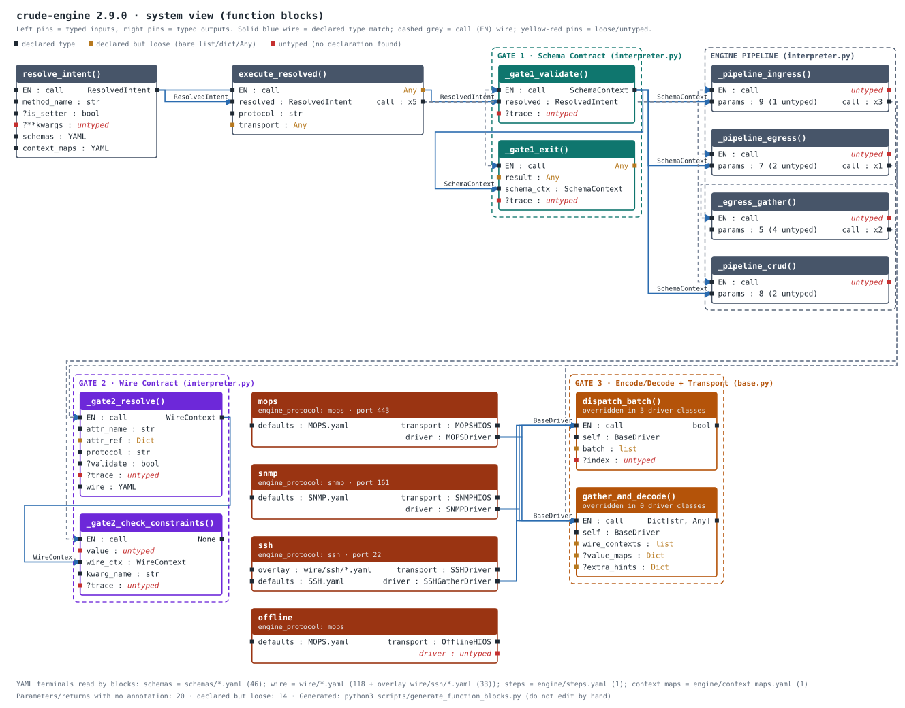
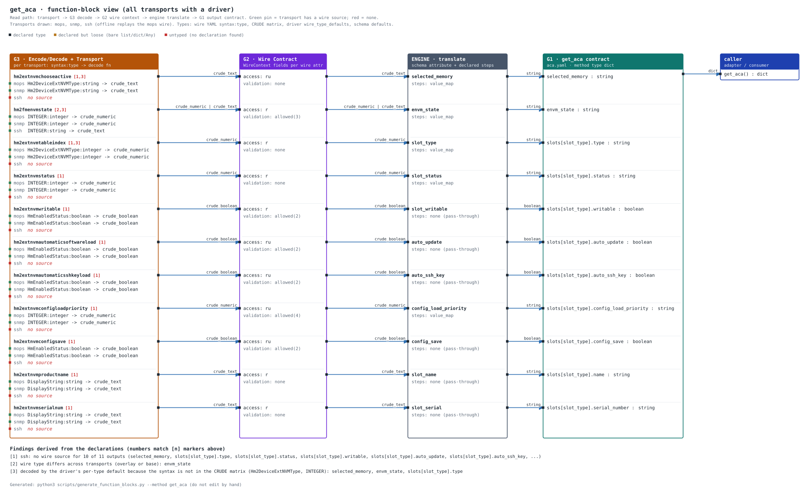

<!-- GENERATED FILE - do not edit by hand. -->
<!-- Generator: scripts/generate_function_blocks.py - regenerate with: python3 scripts/generate_function_blocks.py -->

# Function-block views (generated)

IEC 61131-style function-block diagrams of the engine: each block has typed inputs on the left and typed outputs on the right, and every wire is labelled with the declared type. They are **generated from the repository's own declarations** (Python annotations, `transport_registry.py`, wire/schema YAML, the CRUDE matrix and driver defaults) - nothing is hand-drawn. Where a type is not declared the pin is drawn `untyped` in red; a bare `list`/`dict`/`Any` is drawn amber.

Regenerate: `python3 scripts/generate_function_blocks.py`

Check for drift: `python3 scripts/generate_function_blocks.py --check`

## System view

Annotation gaps on the drawn functions: 20 with no annotation (red), 14 declared but loose (amber).

No annotation:

- `_egress_gather(schema_attrs)`
- `_egress_gather(method_def)`
- `_egress_gather(protocol)`
- `_egress_gather(transport)`
- `_egress_gather -> (return)`
- `_gate1_exit(trace)`
- `_gate1_validate(trace)`
- `_gate2_check_constraints(value)`
- `_gate2_check_constraints(trace)`
- `_gate2_resolve(trace)`
- `_pipeline_crud(trace)`
- `_pipeline_crud(**kwargs)`
- `_pipeline_crud -> (return)`
- `_pipeline_egress(trace)`
- `_pipeline_egress(index_list)`
- `_pipeline_egress -> (return)`
- `_pipeline_ingress(trace)`
- `_pipeline_ingress -> (return)`
- `dispatch_batch(index)`
- `resolve_intent(**kwargs)`

Declared but loose (bare container or `Any`):

- `_gate1_exit(result) : Any`
- `_gate1_exit -> Any`
- `_gate2_resolve(attr_ref) : Dict`
- `_pipeline_crud(transport) : Any`
- `_pipeline_egress(transport) : Any`
- `_pipeline_ingress(kwargs) : dict`
- `_pipeline_ingress(index_list) : list`
- `_pipeline_ingress(transport) : Any`
- `dispatch_batch(batch) : list`
- `execute_resolved(transport) : Any`
- `execute_resolved -> Any`
- `gather_and_decode(wire_contexts) : list`
- `gather_and_decode(value_maps) : Dict`
- `gather_and_decode(extra_hints) : Dict`

## `get_aca`

Findings derived from the declarations:

1. ssh: no wire source for 10 of 11 outputs (selected_memory, slots[slot_type].type, slots[slot_type].status, slots[slot_type].writable, slots[slot_type].auto_update, slots[slot_type].auto_ssh_key, ...)
2. wire type differs across transports (overlay or base): envm_state
3. decoded by the driver's per-type default because the syntax is not in the CRUDE matrix (Hm2DeviceExtNVMType, INTEGER): selected_memory, envm_state, slots[slot_type].type

## How blocks, pins and types are derived

| Element | Source |
|---|---|
| Gate / pipeline / driver blocks | `FeatureEngine` and `BaseDriver` methods, read with `ast` (not imported) |
| Pin names and types | the function's annotations; no annotation -> `untyped` |
| Gate titles and frames | `### Gate N` headings in `docs/ARCHITECTURE.md` |
| Typed wires | a return type that matches another block's parameter type |
| Dashed wires | calls from one drawn block to another (enable pin) |
| Protocol blocks | `crude_engine/transport_registry.py` `PROTOCOLS` |
| Per-method rows | schema `defaults`/`sub_tables` -> attribute `wire`/`source` -> wire YAML (+ protocol overlay) |
| Decode function | explicit source `tag`, else CRUDE matrix `(syntax, type)`, else driver `wire_type_defaults`, else `untyped` |
| Gate 1 type | Python type of the schema `defaults` value |
